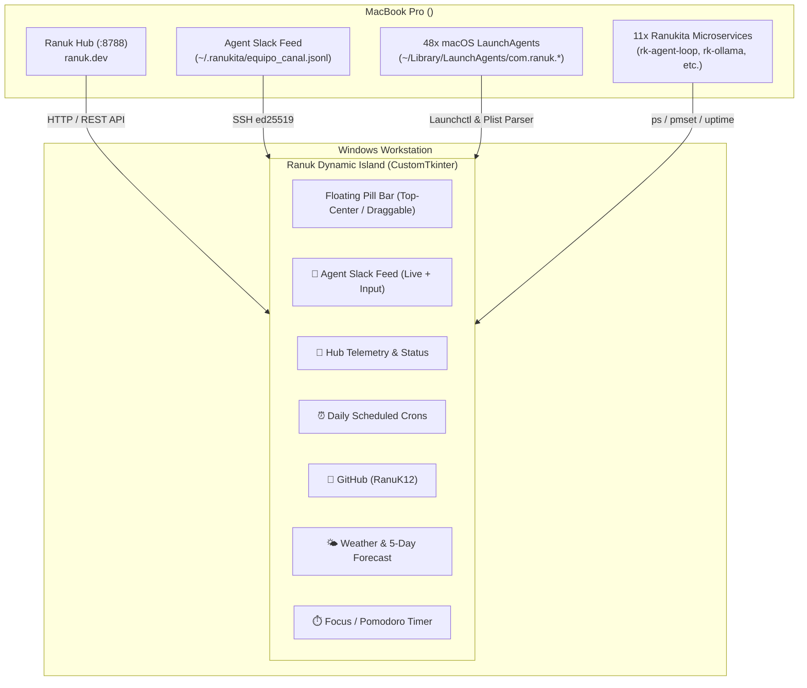

# 🏝️ Ranuk Dynamic Island — Mini Office Companion for Windows

[](LICENSE)
[](https://microsoft.com)
[](https://apple.com)
[](https://www.python.org/)
[](https://ranuk.dev)

A sleek, privacy-focused, Apple-inspired **Dynamic Island desktop companion** for Windows, engineered natively in Python to act as a **lightweight personal command center**. 

It bridges your Windows workstation with your remote **MacBook Pro**, streaming real-time telemetry from **Ranuk Hub**, your autonomous **AI Employee Agents (Slack Feed)**, scheduled daily **macOS LaunchAgents crons**, and **GitHub repositories** — all while maintaining an ultralight footprint (**< 45 MB RAM**, **0% CPU** at idle).

---

## ✨ Key Highlights

- **🍏 Apple Glassmorphism Aesthetic:** Translucent dark acrylic finish, rounded floating pill geometry, smooth easing transitions, and native Windows `Always-on-Top` docking.
- **🤖 Ranuk Hub Live Telemetry:** Direct integration with [Ranuk Hub](http://<MAC_IP>:8788/) (`ranuk.dev`), monitoring active microservices (`rk-agent-loop`, `rk-scan-server`, `rk-ollama-loop`, etc.), MacBook Pro battery percentage, and system uptime.
- **💬 Autonomous Agent Slack Feed:** Live stream of executive messages and task proposals from `~/.ranukita/equipo_canal.jsonl` with avatar badges (`director_general`, `moltbot`, `procurement_apis`, `micro_monetizer`, `bounty-hunter`). Includes an interactive input bar to dispatch CEO directives directly from Windows.
- **⏰ Daily Crons & Agenda:** Automatically discovers and tracks all 48+ scheduled daily calendar tasks from `~/Library/LaunchAgents/com.ranuk.*.plist`, visually flagging completed jobs (`✔`) and highlighting upcoming tasks (`⭐ PRÓXIMO`).
- **🐙 GitHub Ecosystem (`RanuK12`):** Direct monitoring of public and private repository updates, stars, and languages for [github.com/RanuK12](https://github.com/RanuK12).
- **🌤️ Hyper-Local Weather & 5-Day Forecast:** Real-time conditions (temperature, apparent feels-like, humidity, wind speed, UV index) plus a multi-day forecast with daily rain probabilities powered by Open-Meteo.
- **⏱️ Focus / Pomodoro Timer:** Built-in 25-minute workflow timer with pause, resume, and reset.
- **🔒 Zero Third-Party Cloud Dependencies:** 100% open-source, private LAN communication over local SSH and local HTTP loopback. No telemetry or external server tracking.

---

## 🏛️ Architecture Overview



---

## 🚀 Quick Start

### 1. Prerequisites
- **Windows 10 / 11** with Python 3.10+
- **macOS machine** on the same local network with Remote Login (SSH) enabled

### 2. Installation
Clone the repository:
```bash
git clone https://github.com/RanuK12/Ranuk-Dynamic-Island.git
cd Ranuk-Dynamic-Island
```

Install the lightweight dependencies:
```bash
pip install customtkinter requests pillow
```

### 3. macOS SSH Key Pairing (One-Time Setup)
Generate an SSH key on your Windows PC (if not already present):
```powershell
ssh-keygen -t ed25519 -N '""' -f "$HOME\.ssh\id_ed25519"
```

Authorize the public key on your MacBook Pro:
```bash
mkdir -p ~/.ssh && echo "<YOUR_ID_ED25519_PUB_KEY>" >> ~/.ssh/authorized_keys
chmod 700 ~/.ssh && chmod 600 ~/.ssh/authorized_keys
```

### 4. Running the Island
- **Silent Background Mode:** Double-click `launch.vbs` or the Desktop shortcut `Isla Dinámica`.
- **Developer / Console Mode:**
  ```bash
  python main.py
  ```

---

## ⚙️ Configuration (`config.json`)

```json
{
  "mac": {
    "host": "<MAC_IP>",
    "user": "<your-user>",
    "port": 22,
    "bot_name": "ranukita",
    "hub_url": "http://<MAC_IP>:8788",
    "check_interval_seconds": 8
  },
  "weather": {
    "city": "Buenos Aires, Argentina",
    "latitude": -34.6037,
    "longitude": -58.3816,
    "check_interval_seconds": 1200
  },
  "github": {
    "username": "RanuK12",
    "token": "",
    "check_interval_seconds": 300
  },
  "ui": {
    "collapsed_width": 320,
    "collapsed_height": 42,
    "expanded_width": 660,
    "expanded_height": 450
  }
}
```

---

## 🖼️ UI Views

| View | Description |
| :--- | :--- |
| **Pill Bar (Idle)** | Ultra-compact pill docked at top center. Shows live Ranukita health dot, current weather (`☁️ 17°`), real-time clock, and a rolling ticker of the latest agent directive. Click to expand; drag anywhere to reposition. |
| **Agent Slack** | Live chat feed of autonomous agents proposing tasks, financial deals, and AST security audits. Includes CEO directive dispatch box. |
| **Ranuk Hub** | Enterprise metrics from `ranuk.dev`, system uptime, battery health, running background processes, and one-click Web Hub launcher. |
| **Crons Agenda** | Full daily timeline of macOS automated tasks (`x-video-promo`, `bilibili-viral-daily`, `profit-morning-brief`, etc.) with countdowns. |
| **Weather** | Current conditions plus 5-day weather forecast with rain probability indicators. |
| **GitHub** | Recent repository activity, stars, and language breakdowns for `RanuK12`. |
| **Focus** | 25-minute Pomodoro timer for deep work sessions. |

---

## 📄 License

Distributed under the **MIT License**. See [`LICENSE`](LICENSE) for full details.

Developed with ❤️ by **Emilio Ranucoli** ([Ranuk IT Solutions](https://ranuk.dev)).
